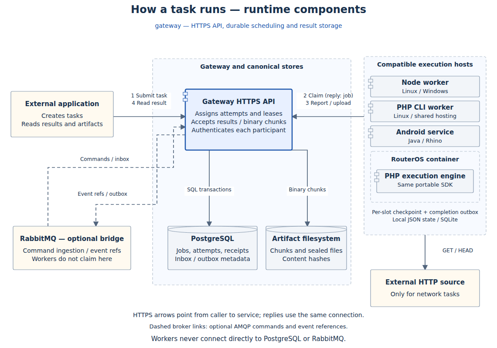
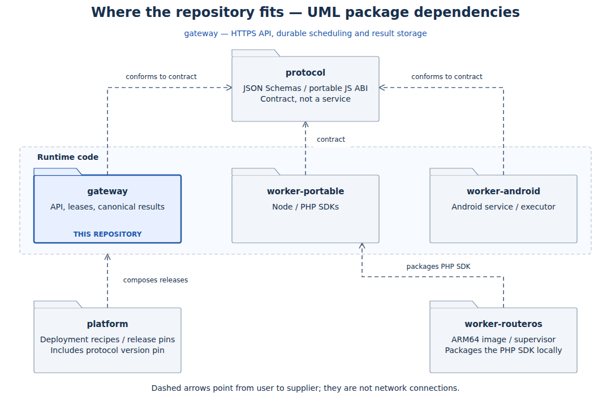

# Fleet gateway

A small HTTPS-facing gateway behind a reverse proxy. Devices use outgoing HTTPS;
PostgreSQL and RabbitMQ stay private on the dedicated fleet server. This process
never connects to the existing Agent Factory queues or its workflow database.
`worker_fleet` tables in the fleet database are the canonical execution ledger.
RabbitMQ carries durable commands and lifecycle/result-reference events.

<!-- fleet-architecture:start -->
## Architecture

### How a task runs



1. An external application submits a task to the gateway API.
2. A compatible worker claims it; the API assigns a fenced attempt in PostgreSQL and returns the task. The worker renews its lease while running.
3. The worker uploads binary output and submits its result. Gateway acknowledgements confirm persisted state.
4. The application reads the canonical result and downloads referenced artifacts.

Workers initiate HTTPS connections. PostgreSQL schedules claims and stores canonical execution state. RabbitMQ is an optional command/event bridge; workers do not pull their tasks from it. The four adapter boxes show implementation types, not a machine count.

### Where this repository fits



The **blue package labelled THIS REPOSITORY** is owned here. Dashed arrows point from a package to the contract, SDK or release bundle it uses; they do not represent network calls. `protocol` and `platform` are source/tooling packages, not running services. RouterOS packages the PHP SDK inside its own container rather than calling a separate PHP service.

This repository owns the HTTPS control API, admission and leases, canonical result receipts, artifact/effect endpoints, and the transactional broker bridge. It stores execution state; computation itself runs on workers.

Implementation: [HTTP API](http.go), [leases and claims](jobs.go), [artifact storage](artifact_store.go), [broker bridge](bridge.go).

Editable sources: [runtime SVG](docs/architecture.svg), [runtime DOT](docs/architecture.dot), [repository SVG](docs/repositories.svg), [repository DOT](docs/repositories.dot). Both view families come from the shared model in [platform](https://gitflic.ru/project/distributed-workers/platform); each repository changes only the ownership highlight. PNG previews display on all three forges. Regenerate with `python3 -B tools/render-architecture.py --workspace ../.. --png` from the platform checkout. SVG needs Python alone; PNG needs local Chromium and Pillow.
<!-- fleet-architecture:end -->

## Build and run

```sh
CGO_ENABLED=0 GOOS=linux GOARCH=amd64 go build -trimpath -o worker-gateway ./cmd/worker-gateway
CGO_ENABLED=0 GOOS=linux GOARCH=amd64 go build -trimpath -o fleetctl ./cmd/fleetctl
CGO_ENABLED=0 GOOS=linux GOARCH=amd64 go build -trimpath -o fleet-relay ./cmd/fleet-relay
```

Required environment:

- `DATABASE_URL`: connection to the **new fleet database**. Runtime role needs
  CONNECT and ownership/USAGE/CREATE within its precreated `worker_fleet` schema,
  rather than CREATE for the whole database. Init creates the schema only when
  absent, and never needs superuser. Migrations must own the fleet tables.
- `WORKER_ADMIN_TOKEN`: a separate random administrator credential.
- `WORKER_BIND`: default `127.0.0.1:18220`.
- `WORKER_RELEASE_DIR`: directory containing `android-stable/manifest.json` and
  versioned APK files. Keep release-signing private keys outside this directory
  and outside the gateway server.
- `WORKER_AMQP_URL`: optional dedicated fleet broker/vhost connection. When set,
  gateway runs the real outbox publisher and command consumer. When using the
  standalone `fleet-relay`, provide this variable to the relay, not the gateway.
- `WORKER_ARTIFACT_DIR`: private persistent filesystem for streamed artifacts.
  Without it, legacy JSON jobs work and artifact writes return 503. The service
  user needs write access; the directory is never an nginx document root.

The reverse proxy must strip a configured base prefix, e.g. `/fleet`, while
preserving the relative routes documented in [the protocol contract](https://gitflic.ru/project/distributed-workers/protocol).
No job execution is tied to the lifetime of an HTTP request. Device requests
use a 16 MiB JSON control budget. Binary chunk routes stream directly to private
storage with a fixed copy buffer and no aggregate artifact-size deadline or cap.

## Worker identity and resource admission

An administrator creates an enrollment credential with
`POST /v1/admin/enrollments {}`. Its hash is stored without a worker identity
until the device calls `POST /v1/workers/connect {}`. Connect requires that
credential and `X-Worker-Profile`: unpadded base64url of the protocol's schema 1
JSON profile. The server atomically assigns a UUID. Retrying the same credential,
including after losing the reply or restarting either side, returns the same ID;
the bearer credential remains unchanged. Existing device tokens retain their
legacy IDs. There is no anonymous registration or client-selected new ID.

Profiles contain capability names and numeric CPU/RAM/disk/GPU availability only.
Unknown values remain unknown; model names, hostnames and serials are rejected.
`GET /v1/workers/me` exposes only the caller's stored profile and server observation
time. `GET /v1/jobs/current` returns only its own live assignment, without extending
the lease. Fleet/history views require the separate administrator credential.

Heartbeat and claim accept an optional profile header for legacy compatibility.
When present, its capabilities are authoritative; conflicting body capabilities
return 400. New jobs can declare `resource_requirements` for available CPU cores,
RAM, disk, GPU count, per-GPU compute units and allocatable GPU memory. Positive
requirements need a fresh profile on that claim RPC; stored old availability is
never reused. Ordinary jobs remain available to legacy clients. Eligibility is
filtered in SQL before the queue limit/row locks, so unsuitable jobs do not hide
a later compatible job. Dedicated GPUs are preferred over shared-memory devices;
unified or unknown-sharing GPU memory also consumes the available host-RAM budget.
GPU total memory alone does not prove an allocation budget.

## Streamed results and external effects

Create `/v1/jobs/{job}/artifacts` with the attempt identity, stable `key`, optional
metadata-only `name`, and `media_type`. PUT raw chunks to
`/v1/artifacts/{upload_id}/chunks/{offset}` with the device bearer token and
`X-Worker-Id`, `X-Attempt-Id`, `X-Fencing-Token`. An ACK advances `next_offset` only
after file fsync and PostgreSQL commit. Status returns the durable `offset`,
`last_segment` and `segments_count`; it does not buffer an unbounded manifest.
Finish with the exact `length` and optional expected `sha256`. The receipt includes
`artifact_id`, `name`, `sha256`, `length`, `media_type`, `committed` and
`candidate_saved`. This seals storage, not the job result. `Complete.artifact_ids`
is checked against sealed artifacts of the same job and the current job fence.

One-chunk results are hard-linked into content-addressed storage. Multi-chunk
results are merged with bounded memory. Redundant segments are reclaimed only
after the complete object and committed PG record are verified. Reconciliation
recovers interrupted cleanup; duplicate chunk/finish requests return stable ACKs.
Aborted streams do not publish partial segments. An explicit abort retains already
acknowledged segments. Stale attempt outputs remain candidates, and a current
attempt may explicitly adopt a sealed earlier-attempt output of the same job.

`GET /v1/admin/artifacts/{id}/content` requires the admin token. The worker content
route requires device/attempt headers and a current live attempt of the same job.
Artifact/effect status and cached begin-response replay have the same restriction;
the former creator loses read access after expiry, reassignment or completion.
Late write receipts and candidate outputs are still retained. Neither route
exposes filesystem paths.
Keep PG metadata and artifact storage together when backing up or restoring.
The filesystem must support atomic hard links and fsync; no expiration deletes
candidate or canonical objects implicitly.

HTTP effect intents use `/v1/jobs/{job}/effects/{effect_id}/begin` and `/finish`.
Begin receives an execution UUID and the original request object; the server
normalizes defaults and headers and returns its request SHA-256. Retrying a lost
begin RPC with the same live execution UUID preserves the execution grant. A new
execution cannot repeat an unresolved `never` mutation; it receives `uncertain`.
Completed responses are replayed across attempts. `safe` is limited to GET/HEAD;
`idempotent` requires a matching vendor idempotency header and key. Finish checks
the reserved execution and hash, preserves late candidates and returns a stable
receipt. HTTP status/body interpretation remains a worker operation.

RabbitMQ receives small artifact/effect/result references. Binary bodies, large
response metadata and attachment lists stay in file storage/PostgreSQL. Reverse
proxies must disable request/response buffering for binary routes and remove
request-size caps there. JSON controls retain their separate budget. The Go
listener has header/idle protection but no overall read/write deadline, and
graceful shutdown drains active requests rather than imposing a fixed deadline.

## Pilot operations

`fleetctl` reads `WORKER_API_URL` (default `http://127.0.0.1:18220`) and
`WORKER_ADMIN_TOKEN` from its environment. Commands:

- `fleetctl init-worker`: creates a pending enrollment credential; the device
  obtains its server ID through connect. Supplying `DEVICE-ID` preserves the
  legacy administrator registration flow. Capture credentials only into private
  provisioning storage, never logs.
- `fleetctl enqueue job.json`: submits `{operation,input,script?,required_capabilities?,resource_requirements?,idempotency_key?}`.
- `fleetctl status [JOB-ID]`, `workers`, `metrics`, `cancel JOB-ID`.

`POST /v1/admin/workers/{id}/policy` or `PATCH /v1/admin/workers/{id}` accepts
`{"update_poll_seconds":30}` for a controlled update test. Set 900 afterwards.
Device heartbeat returns the current value from PostgreSQL, without a restart.

Operations and result JSON are opaque to the gateway; the worker executes them.
Default required capability is the operation name (`sha256`, `text.normalize`,
`javascript`). Explicit capability constraints can target a specialized pool.
Claims are idempotent per `(worker_id, slot_id)`. Resource-aware profiles admit
multiple independent slots; legacy profiles and omitted slot IDs keep slot-zero
single-execution behavior.

## Reliability

A lease lasts 120 seconds; job heartbeats renew it without a maximum job age.
PostgreSQL wall-clock checks run after acquiring locks. Lost workers cause a
new attempt with a greater fencing token. Superseded/expired completions are
saved as candidates before `candidate_saved` is returned. Same completion
returns the same receipt; changed content for the same attempt returns 409.
Canonical results, attempts and candidates remain stored. An explicit worker
`failed` result is a business outcome, not retry-budget exhaustion.
Explicit cancellation is reconciled after the worker lease expires, even when
that worker never reconnects. Healthy uncancelled jobs are not reaped by age.

Outbox events are inserted in the same PostgreSQL transaction as job state.
The publisher retires them only after a positive broker confirm **and** no
`Basic.Return`. Uncertain sends can repeat the stable event ID.
Incoming commands commit the inbox and job before a manual broker ACK.
Both quorum queues have `x-delivery-limit=-1`; reconnecting during a database
outage cannot discard a command at RabbitMQ's default poison-message limit.
This single-server pilot is not a replicated HA deployment.

Dedicated broker topology:

- Topic exchanges `fleet.events` and `fleet.commands`.
- Durable quorum queues `fleet.events.audit` (all lifecycle events) and
  `fleet.commands.gateway` (routing key `job.enqueue`).
- Command envelope: `{"event_id":"unique-id","type":"job.enqueue","payload":{"operation":"sha256","input":{"text":"hello"}}}`.
- Result lifecycle events contain `job_id`, `attempt_id`, `status`, `committed`
  and `result_ref`. The referenced result lives in PostgreSQL and is available
  through the admin job endpoint. Invalid commands and conflicting event IDs
  are retained for inspection, not silently dropped.

These are isolated fleet queues. No adapter consumes existing Agent Factory
fixed-operation queues automatically; any later integration needs an explicit
capability mapping and separately authorized publisher.

## Verification

```sh
REGISTRY_TEST_DATABASE_URL=... go test -race -count=1 -v ./...
REGISTRY_TEST_DATABASE_URL=... FLEET_TEST_AMQP_URL=... go test -count=1 -v -run '^TestBroker' .
```

PostgreSQL fixtures use fresh schemas and remove them afterward. The optional
role-isolation test also needs CREATE ROLE in the test environment; runtime does
not. Broker tests use unique `fleet.test.*` objects in the dedicated test/fleet
vhost and clean up only those objects. They verify an unroutable positive
confirm without losing the outbox, 25 real unacknowledged redeliveries, command
idempotence, actual SHA-256 execution and persistent result-event publication.
Do not pass connection secrets on the command line or record them in test logs.

Queue consumers can send `Prefer: wait=20` to `/v1/jobs/claim` or `/v1/admin/jobs/wait`. Committed PostgreSQL notifications wake waiting requests; idle renewal windows do not limit running computations. Admin consumers should also send `return=minimal` to receive terminal IDs and result references, then read `/v1/admin/jobs/{id}/result` once. This avoids aggregating large results or repeatedly transferring job inputs and history. Binary artifacts remain streamed.

### Adaptive execution slots

Claims support `slot_id`, defaulting to zero. An optional profile `execution`
budget controls simultaneous admission without changing the worker identity.
Repeating a claim recovers only that slot's live attempt. Zero pauses new
admission and does not cancel a lease. Legacy profiles retain single-slot
behavior. Startup adds the slot column and live-slot index to the dedicated
worker schema; all existing attempts migrate to slot zero.

<!-- fleet-examples:start -->
## Runnable examples and measured results

A local computation needs no source service:

```json
{
  "operation": "sha256",
  "input": {
    "text": "abc"
  },
  "required_capabilities": [
    "sha256"
  ]
}
```

Expected result: `{"sha256":"ba7816bf8f01cfea414140de5dae2223b00361a396177a9cb410ff61f20015ad"}`. The same task runs on Node, PHP and Android.

The [binary download example](https://github.com/hawkab/distributed-workers-protocol/blob/main/examples/mirror-download.json) fetches a public signed runtime ZIP and streams it to gateway artifact storage. Its expected SHA-256 is pinned in [the example assertions](https://github.com/hawkab/distributed-workers-protocol/blob/main/examples/benchmark/expected.json). The runner downloads the sealed artifact independently and verifies every byte. Worker task payloads are not staged as local files.

A producer can also submit the hash directly with the built CLI:

```sh
printf '%s\n' '{"operation":"sha256","input":{"text":"abc"},"required_capabilities":["sha256"]}' | ./fleetctl enqueue -
./fleetctl status JOB_ID
```

The returned job ID belongs to the caller's deployment; replace `JOB_ID` with it. The gateway transports the operation and records its receipt; a worker computes the hash.

Run the shared client as a **producer/operator with an administrator credential**, not with a worker token. Keep the [protocol checkout](https://gitflic.ru/project/distributed-workers/protocol) beside this checkout:

```sh
mkdir -p .local
cp ../protocol/examples/benchmark/runner.example.json .local/examples.local.json
# Configure your API base and an owner-readable token file in that local JSON.
python3 -B ../protocol/tools/run-examples.py \
  --config .local/examples.local.json \
  --state .local/example-run/state.json \
  --output .local/example-run/measurements.json \
  --scenario sha256 --scenario mirror-download --repetitions 5
```

Repeat the command to resume its saved jobs after interruption. It reconciles the same idempotency keys, retains failed/interrupted evidence, and never gives a running job an overall deadline. `required_capabilities` and `resource_requirements` select a pool; `allowed_worker_ids` checks the actual executor afterward. A label alone does not select a platform. Keep these routing settings and all identity receipts private. The exported measurements contain neither endpoints, credentials nor worker/job IDs.

Measured 26–27 November 2026 (UTC+03), using SDK 0.8.4 and Android 0.8.0.

| Executor | Task | Completed / planned | Queue, median s | Execution/result, median s |
| --- | --- | --- | --- | --- |
| Node / Linux | SHA-256: abc | 5 / 5 | 0.032 | 0.795 |
| PHP / shared hosting | SHA-256: abc | 5 / 5 | 1.456 | 0.899 |
| PHP / RouterOS ARM64 | SHA-256: abc | 5 / 5 | 0.294 | 0.960 |
| Android / ARM64 | SHA-256: abc | 5 / 5 | 0.275 | 1.873 |
| Android / ARM64 | Word count: 50,000 tokens | 5 / 5 | 0.315 | 2.888 |
| Node / Linux | ZIP stream: GitFlic | 5 / 5 | 0.029 | 83.887 |

Times distinguish queue wait from execution **including task work and result delivery**. They are live-system observations under existing load, not pure CPU timings. Complete cohorts use five trials each; see the [full measurements and method](https://github.com/hawkab/distributed-workers-protocol/blob/main/docs/EXAMPLES.md).
<!-- fleet-examples:end -->
